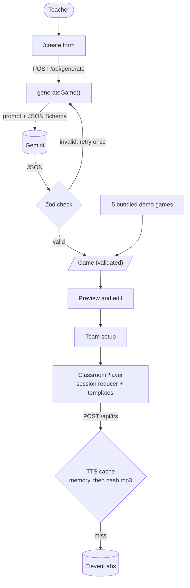

# Element

**Classroom learning games for grades 1–4, generated by AI, played together on the projector.**

<!-- TODO: replace OWNER/REPO once the repository is on GitHub. -->
[](https://github.com/OWNER/REPO/actions/workflows/ci.yml)

## Summary

- **For elementary school teachers:** pick a subject (math, English, science), a topic, grade 1–4, a game type and a language (English or German). Gemini writes the game in a few seconds.
- **Three game types:** quiz, matching pairs, and true or false. All three use fixed, tested templates. The AI only writes content, never code.
- **The teacher stays in control:** every game opens in a preview where questions can be edited or deleted before anyone plays.
- **Classroom mode:** full screen, big buttons that fit a 720p projector, the whole class or 2–4 teams with a scoreboard, confetti on correct answers, and keyboard shortcuts for presenter clickers.
- **Read aloud:** a 🔊 button reads the question and the answers for children who can't read yet (ElevenLabs, cached).
- **Demo mode:** five built-in games, playable without any API keys.

## Origin story

<!-- TODO: fill in the details below. Keep it short: 3–5 sentences. -->

Element started at the **Major Hacking League hackathon in Linz** <!-- TODO: month and year -->.
Our team, **[Teammate 1]**, **[Teammate 2]**, **[Teammate 3]** and me <!-- TODO: names, or remove the placeholders you don't need -->, built the first version in <!-- TODO: e.g. "48 hours" -->.

<!-- TODO: What problem did you set out to solve? What did the hackathon version do, and how did it go (placement, feedback)? -->

After the hackathon I rebuilt it from scratch as a clean, tested project. <!-- TODO: adjust if this isn't accurate. -->

## Screenshots

<!-- TODO: add images to docs/screenshots/ and replace each "coming soon" with  -->

| Screen | Suggested file |
|---|---|
| Demo games list | _coming soon_ <!-- docs/screenshots/demo.png --> |
| Create form | _coming soon_ <!-- docs/screenshots/create.png --> |
| Preview and edit | _coming soon_ <!-- docs/screenshots/preview.png --> |
| Quiz with teams (projector, 1280×720) | _coming soon_ <!-- docs/screenshots/quiz-teams.png --> |
| End screen | _coming soon_ <!-- docs/screenshots/end.png --> |

## Quick start

You need **Node.js 24**. With [nvm](https://github.com/nvm-sh/nvm), `nvm use` picks it from `.nvmrc`.

```bash
npm ci
```

```bash
npm run dev
```

Then open <http://localhost:3000>.

### Without API keys

Everything that doesn't need an AI service works:

- `/demo`: all five sample games (EN and DE), including preview/edit, teams and confetti.
- `/create`: the form works, and submitting shows "Game generation isn't set up yet" with a link to the demo games.
- The read-aloud button is hidden.

### With API keys

Copy the example file, fill in what you need, and restart `npm run dev`:

```bash
cp .env.example .env.local
```

| Variable | Needed for | Default |
|---|---|---|
| `GEMINI_API_KEY` | Generating games at `/create` | (none) |
| `GEMINI_MODEL` | Choosing the Gemini model | `gemini-3.8-flash` |
| `ELEVENLABS_API_KEY` | The read-aloud button | (none) |
| `ELEVENLABS_VOICE_ID` | Choosing the voice | ElevenLabs example voice, **retired on 2026-12-31**, so set your own |
| `ELEVENLABS_MODEL_ID` | Choosing the TTS model | `eleven_multilingual_v2` |
| `TTS_CACHE_DIR` | Where cached audio is stored | `.cache/tts` (use e.g. `/tmp/tts` on serverless hosts) |

Keys are read only by server-side route handlers and never reach the browser. `.env.local` is ignored by git.

### Scripts

| Command | What it does |
|---|---|
| `npm run dev` | Development server on port 3000 |
| `npm run build` / `npm start` | Production build / serve it |
| `npm run lint` | ESLint |
| `npm run typecheck` | Generates Next.js route types, then runs `tsc` |
| `npm test` | All tests once (Vitest + Testing Library) |
| `npm run test:watch` | Tests in watch mode |

CI (`.github/workflows/ci.yml`) runs lint, typecheck, tests and build on every push to `main` and every pull request. It needs no secrets, because Gemini and ElevenLabs are mocked in every test.

## Architecture



```
src/
├── app/
│   ├── api/generate/route.ts   Gemini route: validate → generate → check → retry once
│   ├── api/tts/route.ts        TTS route: GET = enabled?, POST = MP3 (cached)
│   ├── create/                 Teacher form
│   └── demo/                   Demo list and /demo/[id]
├── components/
│   ├── games/                  Quiz, matching, true/false templates (presentational)
│   ├── classroom/              Player, scoreboard, team setup, confetti, read aloud
│   ├── preview/                Preview/edit screen
│   ├── create/                 Create form and flow
│   └── GameFlow.tsx            Preview → team setup → play
├── data/samples/               The 5 demo games
└── lib/
    ├── schemas.ts              Zod schemas: content (AI) and game (app)
    ├── game/                   Session reducer, scoring, teams, shuffle, edit helpers
    ├── generate/               Prompt, Gemini client, retry logic
    ├── tts/                    Cache, ElevenLabs client, read-aloud text
    └── i18n.ts                 EN/DE strings for the classroom screens
```

## Key decisions

- **Two layers of schemas.** *Content* schemas describe only what Gemini returns: questions, options, pairs. *Game* schemas add the teacher's metadata and app-assigned ids. An AI model can't be trusted to invent unique ids or to repeat the grade correctly, so we never ask it to.
- **Structured output *and* Zod.** Gemini gets a JSON Schema generated from the Zod schema, so the two can't drift apart. JSON mode can't check rules like "the correct answer is one of the options" or "no duplicate cards", so Zod checks every answer.
- **Retry once, and only on invalid output.** The second prompt lists the exact problems. If the model call itself fails (rate limit, outage, timeout), the teacher gets an error at once: retrying would most likely fail again and double the wait.
- **The topic is data, not instructions.** Fixed rules go in the system instruction; the teacher's topic is passed quoted, and the model is told to ignore instructions inside it.
- **One pure reducer runs the game.** Templates only report what was tapped. The reducer decides whether it's correct, gives points and passes turns. All rules live in one tested place, and a double tap can't score twice.
- **The TTS cache key is a hash of text + language + voice + model.** The same sentence in another voice is different audio. Requests for the same text that arrive at the same moment share one ElevenLabs call, and failures are never cached.
- **Keys stay on the server.** The Gemini and ElevenLabs clients are marked `server-only`, so the build fails if browser code ever imports them.
- **Built for a projector.** Every screen fits 1280×720. Answer tiles have a color *and* a shape (▲ ◆ ● ■) for color-blind children, and the Andika typeface is designed for beginning readers.
- **A typed dictionary instead of an i18n library.** About 40 strings in EN and DE; a missing German string is a compile error.
- **Next.js 16 specifics.** With Cache Components on, `/demo/[id]` reads `params` inside `<Suspense>` so navigation stays instant. `GET /api/tts` calls `connection()` so a new key is picked up at runtime, not baked in at build time.

## Privacy

- **No accounts, no student data, no cookies, no analytics.** Nothing about the children is collected or stored. A teacher's edits live only in the browser tab.
- **What is sent to third parties:**
  - When generating a game, Gemini (Google) receives the subject, topic, grade, game type and language.
  - When reading aloud, ElevenLabs receives the question and answer text.
  - No names or personal data are part of either request.
- **What is stored:** read-aloud audio is cached on the server as `<hash>.mp3` files, containing only question text. Server logs record error types and status codes, never API keys or prompt text.
- **Before using it in a school, check the providers' data terms.** They differ by plan and by region. For example, Google may use input to unpaid Gemini API services to improve its products, while paid services don't. Users in the EEA, Switzerland and the UK get the paid-service data terms even on the free tier. Review:
  - [Gemini API Additional Terms of Service](https://aistudio.google.com/docs/terms)
  - [ElevenLabs Privacy Policy](https://elevenlabs.io/privacy-policy)

## How I used AI

<!-- Write this section yourself. -->
